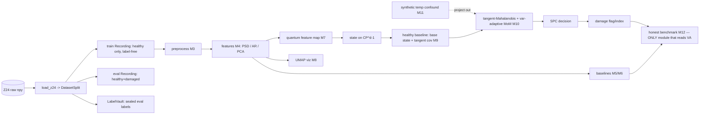

# CHECKPOINT — End of M2 (2026-06-19)

**Purpose:** a self-contained resume anchor. A future session should be able to
read *only this file* (plus `PROGRESS_LOG.md` for the full decision history) and
continue the project without re-deriving prior context. Live detail lives in
`PROGRESS_LOG.md`; dataset provenance in `DATASET_REPORT.md`.

---

## 0. Project identity

**Q-GUARD** — *Quantum Geometry-aware Unsupervised Anomaly detection for
vibration-based Damage detection.* Curvature-aware novelty scoring on the
pure-state manifold (`CP^{d-1}`) for **label-free, environment-robust**
structural health monitoring (SHM), benchmarked **honestly** against classical
baselines. **No quantum-advantage claim** — it is a representation/geometry study
runnable entirely on a statevector simulator.

**Convergent thesis (why this project exists).** Three papers describe one
abstract task — *estimate a healthy reference on a curved manifold from streaming
data, then flag deviations, using only baseline data*:
1. **Avci et al. (2021)** — SHM ML/DL review. Gaps: no field damage labels;
   modal features confounded by temperature; non-transferable hand-crafted features.
2. **Sohn, Czarnecki & Farrar (2000)** — SHM = unsupervised novelty detection from
   a healthy baseline (AR features + SPC control charts). Linear/Gaussian/Euclidean.
3. **Lumbreras & Tomamichel (2026, arXiv:2605.09019)** — learning pure qudit
   states "without regret": tangent-space linearization + symmetric retractions
   (cancel curvature) + variance-adaptive Median-of-Means + hot-start, on the
   Fubini–Study manifold. `1 − Tr(ρA) = ½‖ρ−A‖²_F` is literally a manifold novelty score.

Q-GUARD = the first applied realization of paper 3's tangent-space toolkit, used
to modernize paper 2's unsupervised detector, closing paper 1's gaps.

**Constraints (fixed):** simulator-only (≤~12 qubits), 1–2 months, balanced
publication + portfolio. Framework: **PennyLane**. Tracking: **MLflow only**.

---

## 1. Completed milestones

| ID | Milestone | State |
|----|-----------|-------|
| Planning P1–P6 | research analysis → 20 ideas → Q-GUARD → design → architecture → repo → milestones | ✅ |
| **M0** | Repo scaffold & tooling (package `qguard`, pyproject, env, Makefile, MIT, Hydra config, smoke tests) | ✅ |
| **M1** | Z24 acquisition + provenance (download script, SHA-256, DATASET_REPORT, provenance JSON) | ✅ |
| **M2** | Loaders, canonical schema (Recording/LabelVault/SplitMetadata/DatasetSplit), group-aware leakage-free split, label semantics, integrity tests | ✅ |

Git: commit `f5ca8ad` = M0+M1. **M2 is implemented but not yet committed.**
Tests: **12/12 passing** (`python -m pytest`).

## 2. Roadmap (remaining)

M3 preprocess → M4 features + EDA → M5 classical baselines (AR+SPC, PCA+Fisher+SPC)
→ M6 1D-CNN autoencoder → M7 quantum feature maps + exact fidelity kernel →
**M8 embeddings + UMAP (before any quantum-geometry modeling)** → M9 tangent-space
core + MoM (geometry tests) → M10 Q-GUARD scorers (tangent-Mahalanobis primary,
subspace-fidelity, quantum-kernel SVDD) → M11 synthetic environmental-confound
rejection → M12 evaluation + Hydra runner + figures → M13 ablations (feature-map,
shot-noise) + paper-style report → M14 damage localization (stretch).

Experiments: E01 baselines · E02 Q-GUARD · E03 feature-map ablation · E04 env
(synthetic confound) · E05 shot-noise · E06 localization (stretch).

## 3. Current architecture



Layer separation: data → preprocess → features → {quantum | baselines} →
scorers (`NoveltyDetector` protocol, M5) → decision → eval → viz, all
config-driven (Hydra) and tracked (MLflow). **Only `qguard.eval` may read labels.**

## 4. Current file tree

```
QML/  (standalone git repo, branch main; data & mlruns gitignored)
├── README.md  DATASET_REPORT.md  PROGRESS_LOG.md  CHECKPOINT_M2.md
├── pyproject.toml  environment.yml  Makefile  LICENSE  .gitignore
├── configs/config.yaml                      # Hydra root (groups added M3+)
├── src/qguard/
│   ├── __init__.py                          # version, package contract docstring
│   └── data/
│       ├── __init__.py
│       ├── download_z24.py                  # M1: HF fetch + provenance JSON
│       ├── schema.py                        # Recording, LabelVault, SplitMetadata, DatasetSplit
│       └── loaders/{__init__.py, z24.py}    # load_z24, make_split (group-aware), Z24_SCENARIO_NAMES
├── tests/
│   ├── test_pipeline_smoke.py               # M0
│   ├── test_label_quarantine.py             # M2
│   └── test_no_leakage.py                   # M2 (window + group disjoint, healthy-only train)
├── reports/provenance/z24_provenance.json   # M1 (checksums, shapes, label dist)  [committed]
├── docs/ notebooks/ reports/figures/ experiments/results/   (.gitkeep)
└── data/raw/z24/{inputs.npy, labels.npy, README.md, ...}     (GITIGNORED, on disk)
```

## 5. Key design decisions (most load-bearing; full list D1–D36 in PROGRESS_LOG.md)

- **Project = Q-GUARD**; tangent-Mahalanobis primary scorer; ZZ feature map
  primary (+ angle, data-reuploading as ablation axes); classical baselines
  mandatory (AR+SPC, PCA+Fisher+SPC, 1D-CNN AE). No quantum-advantage claims.
- **Single dataset = Z24** (KW51 dropped). Features: PSD (quantum path) + AR
  (Sohn baseline path).
- **Label quarantine is structural:** fit path receives a label-free `Recording`;
  labels only via `LabelVault.reveal(consumer)`; `qguard.eval` is the sole reader.
- **Group-aware split (D35):** Z24 window `i` → group `i // 10` = one (scenario,
  setup) recording's 10 segments; groups never straddle train/eval. Enforced by
  `test_no_leakage.py`.
- **Label semantics (D34):** healthy = label `0`; `Z24_SCENARIO_NAMES` is the
  canonical PDT order as a *documented assumption* (mirror does not publish the
  index map); validate empirically in M4 EDA. Healthy label set is configurable.
- **M11 reframed (D33):** Z24 mirror has **no temperature channel**; the
  environmental-confound study uses a **clearly-labelled synthetic** temperature
  modulation injected into healthy windows — no real-temperature claim.
- **Repo isolated (D30):** the home dir `C:/Users/singh` was an accidental git
  repo; QML was `git init`-ed as its own repo. NEVER run `git add -A` from the
  home dir.
- **MLflow only**; `reports/provenance/` holds machine-readable provenance.

## 6. Verified data facts (2026-06-19)

- `inputs.npy`: (1530, 27, 6000) float32. `labels.npy`: (1530,) int64.
- 17 classes (0–16), **90 windows each**; 1530 = 17 scenarios × 9 setups × 10 segments.
- **No temperature/environmental channel** in this mirror (PDT portion only).
- License: mirror tags **MIT**, but underlying data © **KU Leuven, research use** —
  treat as non-commercial; cite Maeck & De Roeck (2003), Worden & Manson (2007),
  Reynders et al. (2008). SHA-256 in `reports/provenance/z24_provenance.json`.

## 7. Open questions

- **OQ-fs:** Z24 sampling rate assumed **100 Hz** (benchmark value) for the PSD
  frequency axis; mirror does not restate it (`loaders/z24.py: DEFAULT_FS_HZ`).
  Validate against KU Leuven docs before any frequency-domain claim.
- **OQ-label-validation:** confirm in M4 EDA that label 0 forms the tightest,
  most self-consistent feature cluster (sanity-checks the PDT index assumption).
- **OQ-commit:** M2 not yet committed; decide whether to commit standalone or
  bundle with M3.

## 8. Known risks & mitigations

| # | Risk | Mitigation |
|---|------|-----------|
| K1 | **No measurable quantum benefit** vs classical baselines | Reframe as honest comparative study; tangent/geometry contribution stands regardless. Pre-accepted outcome. |
| K2 | **No real temperature** in Z24 mirror → environmental study weakened | M11 reframed (D33) as clearly-labelled *synthetic* confound PoC; real data optional future extension. |
| K3 | **fs assumption (100 Hz)** wrong → PSD frequency axis mislabeled | Flagged OQ-fs; validate vs KU Leuven docs before any frequency-domain claim; features still valid up to axis scaling. |
| K4 | **Label-0 = undamaged assumption** wrong | Configurable healthy set; empirically validate in M4 EDA (tightest cluster). |
| K5 | **Segment-correlation leakage** | Closed by group-aware split (D35) + `test_no_leakage.py`; must be preserved through M3 caching. |
| K6 | **Double-normalization** (mirror already normalized) | M3 treats inputs as cleaned windows; per-channel scaler fit on healthy-train only; documented. |
| K7 | **Home-dir git hazard** (`C:/Users/singh` is a repo) | QML isolated as own repo (D30); never `git add -A` from home. |
| K8 | **Barren plateaus** if deep VQAs used | Design avoids deep trainable circuits; scoring is kernel/geometry-based. |
| K9 | **inputs.npy ~945 MB** memory blowups | Always `mmap_mode="r"`; tests use synthetic arrays; cache processed subsets. |

## 9. Next actions (resume here)

1. (Optional) commit M2 as its own checkpoint.
2. **M3 — preprocessing pipeline:** `src/qguard/preprocess/pipeline.py` with
   composable deterministic transforms (detrend, optional bandpass, per-channel
   normalization **fit on healthy/train only**, fit-stats stored). Note: the
   mirror already windowed+normalized to (…,6000), so treat inputs as cleaned
   windows and do **not** double-normalize. Extend `tests/test_features.py` for
   determinism + healthy-only fit-stat behavior.
3. Then M4 features + EDA (validate OQ-label, resolve OQ-fs impact).

## 10. Environment / how to run

- OS: Windows 11; shells: PowerShell + Git Bash. Active `python` is Python 3.14
  (AppData) — package installed editable there; a conda env `qguard` is defined
  in `environment.yml` for full deps.
- Install: `pip install -e ".[all]"` (or `conda env create -f environment.yml`).
- Tests: `python -m pytest`. Download data: `python -m qguard.data.download_z24`.
- Data lives in `data/raw/z24/` (gitignored) — re-download via the script if absent.
- Heavy array (`inputs.npy` ~945 MB): always load with `mmap_mode="r"`; never
  materialize the full eval slice casually in tests (tests use synthetic arrays).
