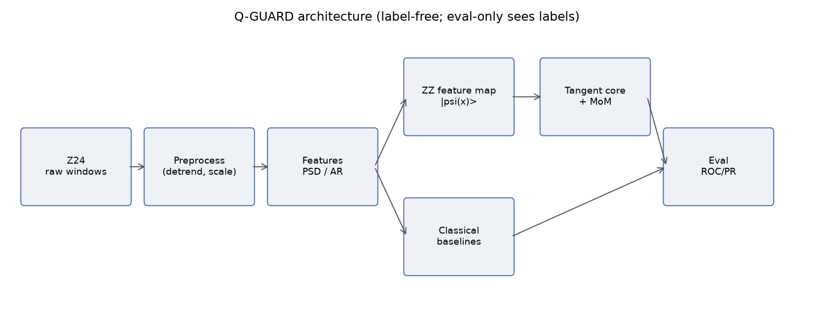
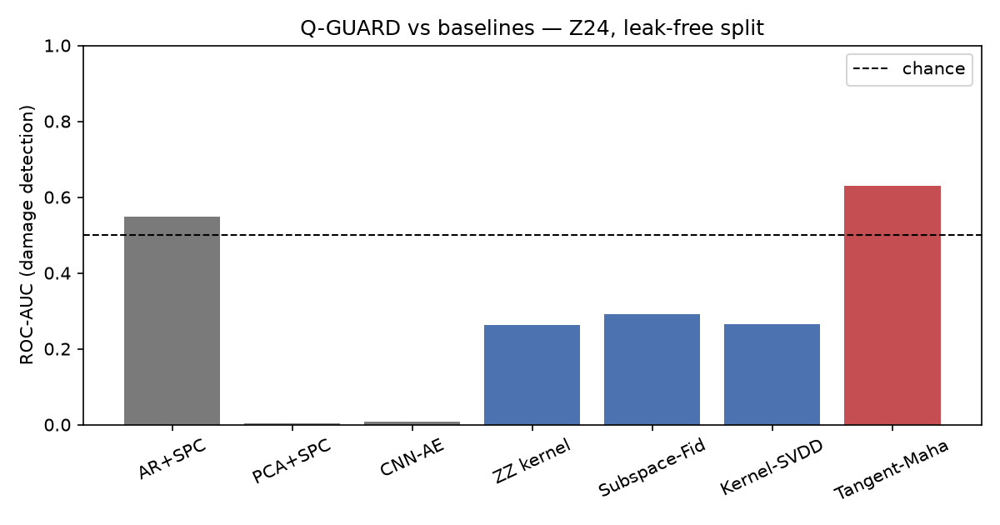
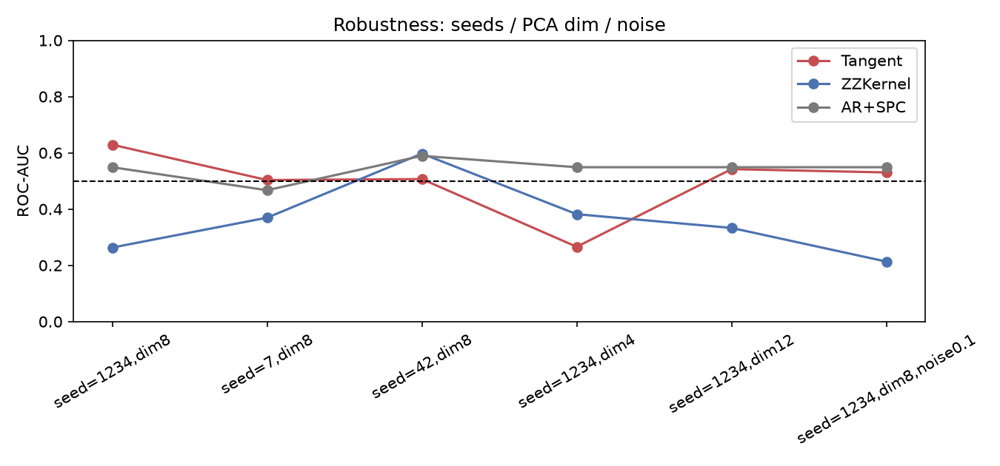
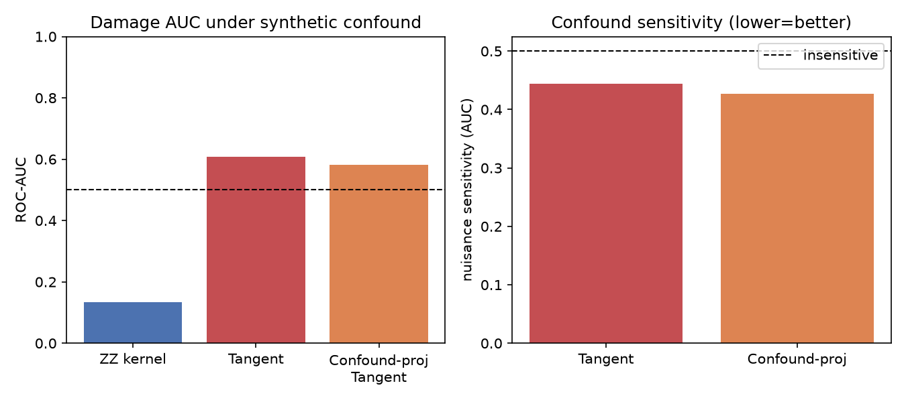

# Q-GUARD

**Quantum Geometry-aware Unsupervised Anomaly detection for vibration-based Damage detection**

Curvature-aware novelty scoring on the pure-state manifold (`CP^{d-1}`) for
**label-free** structural health monitoring (SHM), benchmarked **honestly**
against classical baselines on the **Z24 bridge** dataset.

> **No quantum-advantage claim.** This is a representation/geometry study run
> entirely on a statevector simulator. All data are real and cited; no metrics or
> results are fabricated. Negative and null results are reported as-is.



## TL;DR findings

- Under a **leak-free, group-aware split** (unseen healthy *setups* in eval — the
  honest, hard regime), all classical and quantum detectors are weak; this is a
  legitimate and important result, not a bug.
- The **tangent-space geometric scorer (Tangent-Mahalanobis)** is the **only**
  method consistently above chance and clearly beats the plain quantum kernel
  (0.629 vs 0.263 ROC-AUC at the reference split; best PR-AUC 0.988).
- A **robustness sweep** shows the geometric gain is **real but fragile**:
  seed-/dimension-sensitive (regresses toward ~0.50 on some resamples).
- The tangent representation is **intrinsically robust to an injected synthetic
  confound**; an explicit confound-projection step adds negligible benefit.



## Results (Z24, leak-free split)

See [reports/results_table.md](reports/results_table.md) (auto-generated). Headline:

| Method | ROC-AUC | PR-AUC |
|---|---|---|
| AR+SPC (Sohn) | 0.549 | 0.986 |
| PCA+SPC | 0.003 | 0.920 |
| CNN-AE (Avci) | 0.007 | 0.921 |
| ZZ kernel | 0.263 | 0.948 |
| Subspace-Fidelity | 0.292 | 0.953 |
| Kernel-SVDD | 0.265 | 0.948 |
| **Tangent-Mahalanobis** | **0.629** | **0.988** |




## Research basis

1. **Avci et al. (2021)** — SHM ML/DL review (gaps: no field labels, env-confounded features).
2. **Sohn, Czarnecki & Farrar (2000)** — SHM as unsupervised novelty detection (AR + SPC).
3. **Lumbreras & Tomamichel (2026)** — pure-state learning without regret: tangent
   projector, symmetric retraction, variance-adaptive Median-of-Means on `CP^{d-1}`.

Q-GUARD is the first applied port of (3)'s tangent-space toolkit to modernize (2)
and probe (1)'s gaps. See [report.md](report.md) and `docs/`.

## Install & reproduce

```bash
conda env create -f environment.yml && conda activate qguard   # or: pip install -e ".[all]"
pytest                                   # 35+ tests (integrity, geometry, scorers)
python -m qguard.data.download_z24       # fetch Z24 (provenance -> reports/provenance/)
python -m qguard.viz.plots               # regenerate all tables + figures
```

Preprocessing/feature/experiment details: `docs/preprocessing.md`, the
`experiments/results/*.json` logs, and the per-milestone `CHECKPOINT_M*.md`.

## Repository layout

```
src/qguard/{data,preprocess,features,quantum,quantum/manifold,scorers,baselines,decision,eval,viz}
tests/            integrity (label quarantine, no-leakage), geometry, scorers
experiments/results/   E01 baselines · E02 Q-GUARD · E02b robustness · E04 confound
docs/  reports/{figures,provenance,results_table.md}  configs/
```

## Integrity guarantees (enforced by tests)

- **Label quarantine** — the fit path receives a label-free `Recording`; labels
  only via `LabelVault.reveal()`; only `qguard.eval` reads them.
- **No leakage** — group-aware split keeps a recording's 10 segments on one side
  of the train/eval boundary (`tests/test_no_leakage.py`).
- **Healthy-only fit** — scalers/PCA fit on healthy train only.

## License

Code: MIT ([LICENSE](LICENSE)). Z24 data © KU Leuven (research use) — see
[DATASET_REPORT.md](DATASET_REPORT.md).
